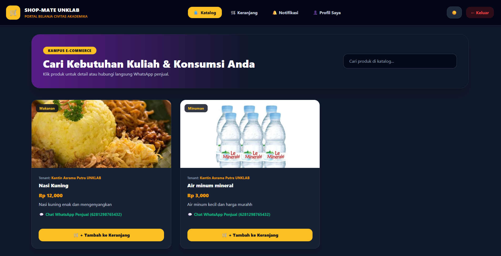
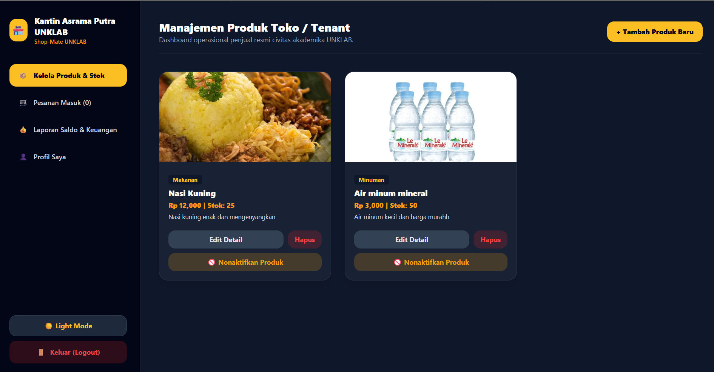
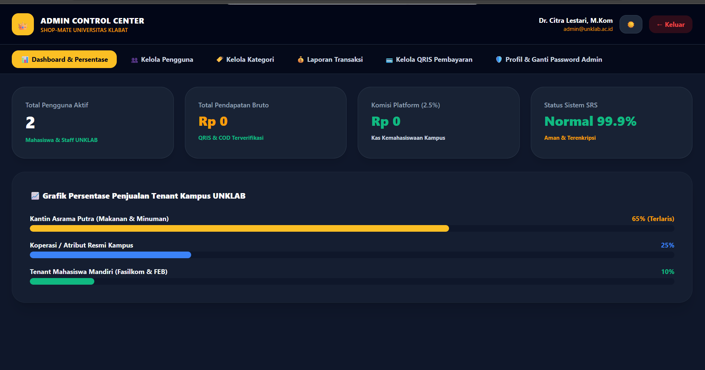
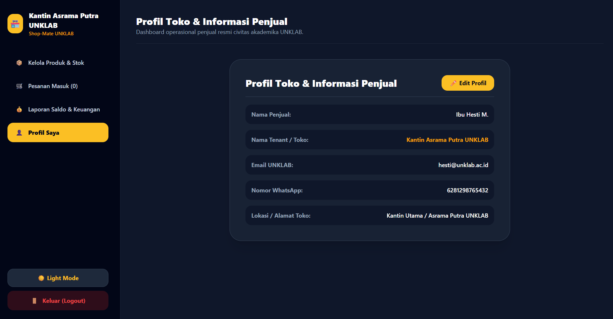
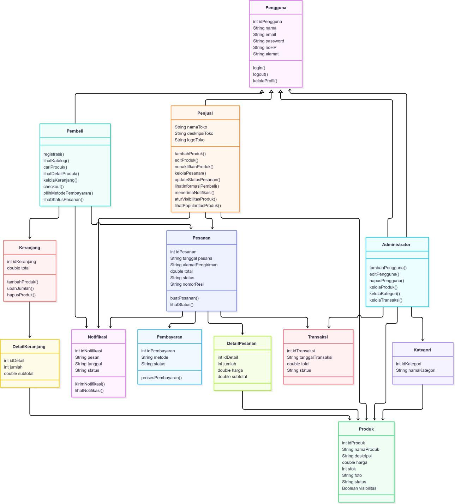
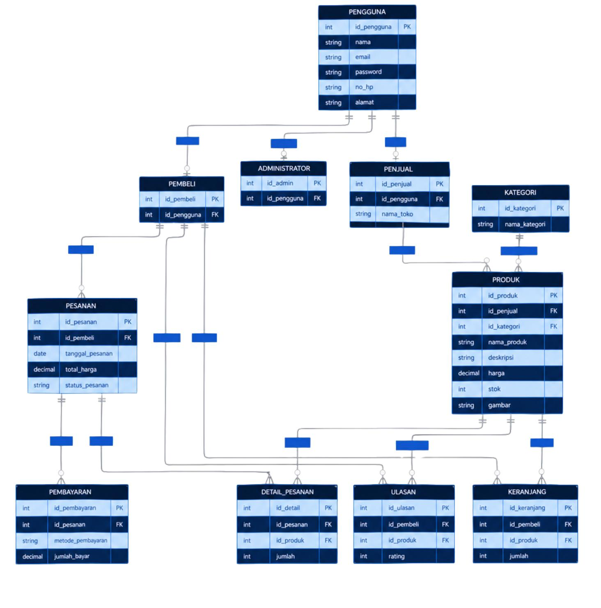

# Shop-Mate UNKLAB

Sistem informasi berbasis web berupa marketplace untuk lingkungan Universitas Klabat yang membantu Pembeli, Penjual, dan Administrator melakukan jual beli, mengelola produk dan pesanan, serta memantau transaksi agar proses jual beli di kampus lebih terstruktur dan tidak lagi tercecer di chat.


| | |
|---|---|
| **Mata kuliah** | System Analysis and Design — Fakultas Ilmu Komputer, Universitas Klabat |
| **Kelompok** | Well |
| **Objek / studi kasus** | Kegiatan jual beli mahasiswa, dosen, dan staf di Universitas Klabat |
| **Model SDLC** | Agile |
| **Dokumen SRS** | [docs/SAD_FP_Kelompok_Well_SRS.pdf](docs/SAD_FP_Kelompok_Well_SRS.pdf) |
| **Prototipe UI** | Tidak memakai Figma. Rancangan 24 halaman (L-01 s.d. L-24) ada di SRS Bagian 9, dan aplikasi yang sudah jadi menjadi prototipe yang dapat dicoba |
| **Aplikasi (deploy)** | [https://shop-mate-unklab-xpmy.vercel.app](https://shop-mate-unklab-xpmy.vercel.app) |

## Anggota Kelompok

| No | Nama | NIM | Peran | Kontribusi utama |
|----|------|-----|-------|------------------|
| 1 | Pattilamonia, Christina J. | 105022410098 | Project Manager / Koordinator | Perencanaan jadwal, pengawasan task, koordinasi tim, repository |
| 2 | Palari, Sisiani | 105012410097 | System Analyst | Elisitasi kebutuhan, use case, dan activity diagram |
| 3 | Kartika Sari | [PERIKSA NIM] | System Designer / Analis UML | Arsitektur basis data, ERD, dan class diagram |
| 4 | Ayu Ningsi | 105022410100 | UI/UX Designer | Rancangan antarmuka 24 halaman (L-01 s.d. L-24) |

## Latar Belakang

- **Masalah:** Penjual dan pembeli di kampus kesulitan melacak stok barang dan merekap pesanan karena semua dilakukan lewat chat; sering terjadi miskomunikasi stok.
- **Kondisi saat ini:** Penjual mengunggah foto barang di grup WhatsApp kampus, pembeli menghubungi lewat chat pribadi, harga dan tempat transaksi (umumnya COD di area kampus) disepakati sendiri, dan pencatatan dilakukan manual di buku tulis atau Microsoft Excel.
- **Tujuan sistem:** Menyediakan satu tempat bagi warga kampus untuk menawarkan, mencari, dan memesan produk dengan alur yang jelas (keranjang, checkout, pemilihan metode pembayaran, dan pemantauan status pesanan), serta membantu Administrator mengelola pengguna, produk, kategori, dan transaksi.
- **Pengguna (aktor):**
  - **Pembeli**: mahasiswa, dosen, atau staf yang membeli produk (registrasi, login, katalog, pencarian, keranjang, checkout, status pesanan, profil).
  - **Penjual**: pengguna yang menjual produk (kelola produk, kelola pesanan dan status, lihat informasi pembeli, notifikasi, visibilitas, popularitas produk, profil).
  - **Administrator**: pengelola sistem (kelola pengguna, produk, kategori, transaksi, dan profil).

## Fitur Utama

Setiap fitur dipetakan ke use case dan kebutuhan di SRS (Bagian 5.2 dan 6.3).

| No | Fitur | Aktor | Use case | Kebutuhan |
|----|-------|-------|----------|-----------|
| 1 | Registrasi dan login | Pembeli, Penjual, Administrator | UC-01, UC-02 | FR-01, FR-02 |
| 2 | Katalog, pencarian, dan detail produk | Pembeli | UC-03, UC-04, UC-05 | FR-03, FR-04, FR-05 |
| 3 | Keranjang, checkout, dan metode pembayaran | Pembeli | UC-06, UC-07, UC-08 | FR-06, FR-07, FR-08 |
| 4 | Status pesanan | Pembeli | UC-09 | FR-09 |
| 5 | Kelola profil | Semua aktor | UC-10 | FR-10 |
| 6 | Kelola produk (tambah, edit, nonaktifkan, visibilitas) | Penjual | UC-11, UC-12, UC-13, UC-14, UC-19 | FR-11, FR-12, FR-13, FR-14, FR-19 |
| 7 | Kelola pesanan, status, informasi pembeli, dan notifikasi | Penjual | UC-15, UC-16, UC-17, UC-18 | FR-15, FR-16, FR-17, FR-18 |
| 8 | Popularitas produk | Penjual | UC-20 | FR-20 |
| 9 | Kelola pengguna | Administrator | UC-21, UC-22, UC-23, UC-24 | FR-21, FR-22, FR-23, FR-24 |
| 10 | Kelola produk dan kategori | Administrator | UC-25, UC-26 | FR-25, FR-26 |
| 11 | Lihat dan kelola transaksi | Administrator | UC-27 | FR-27 |

## Screenshot

**Halaman pertama: login dan registrasi (UC-01, UC-02)**


**Dashboard Pembeli: katalog, keranjang, checkout, status pesanan (UC-03 s.d. UC-09)**



**Dashboard Penjual: kelola produk dan stok, pesanan masuk, laporan saldo (UC-11 s.d. UC-20)**



**Dashboard Administrator: pengguna, kategori, laporan transaksi, QRIS (UC-21 s.d. UC-27)**



**Profil Pembeli (UC-10)**


**Profil Penjual (UC-10)**



**Profil dan ganti password Administrator (UC-10)**


**Validasi input: pesan error saat password salah**


## Teknologi

| Lapisan | Teknologi | Versi |
|---------|-----------|-------|
| Front-end | React, Vite, Tailwind CSS, PostCSS, React Router, Lucide React | React 18.2, Vite 5.4, Tailwind CSS 3.4, React Router 7 |
| Back-end | Node.js, Express, mysql2, dotenv, cors | Express 4.19, mysql2 3.9, dotenv 16.4 |
| Database | MySQL untuk akun (registrasi dan login). Data produk, pesanan, kategori, dan transaksi disimpan di `localStorage` browser | MySQL 8 |
| Hosting | Vercel | — |
| Tools pemodelan | draw.io | — |
| Prototipe UI | Tidak memakai Figma (aplikasi jadi berfungsi sebagai prototipe) | — |

## Kebutuhan Sistem

- Node.js 20 atau lebih baru (dan npm)
- MySQL 8 atau XAMPP (MySQL/MariaDB)
- Git
- Browser modern (Chrome, Edge, Firefox)

## Instalasi dan Menjalankan Aplikasi

1. Clone repository:

   ```bash
   git clone https://github.com/s22229040-dotcom/shop-mate-unklab.git
   cd shop-mate-unklab
   ```

2. Pasang dependensi back-end dan front-end:

   ```bash
   cd backend
   npm install
   cd ../frontend
   npm install
   cd ..
   ```

3. Siapkan konfigurasi back-end. Salin file contoh lalu sesuaikan isinya (koneksi database dan port):

   ```bash
   cd backend
   cp .env.example .env
   ```

4. Siapkan database:

   ```bash
   [ISI: buat database "nama_db", lalu impor skema, mis. mysql -u root nama_db < database/schema.sql]
   ```

5. Jalankan back-end (terminal pertama):

   ```bash
   cd backend
   npm start
   ```

6. Jalankan front-end (terminal kedua):

   ```bash
   cd frontend
   npm run dev
   ```

7. Buka [http://localhost:5173](http://localhost:5173) di browser.

8. (Opsional) Build front-end untuk produksi:

   ```bash
   cd frontend
   npm run build
   ```

### Akun uji

Hanya akun uji, bukan akun asli siapa pun.

| Aktor | Username / email | Password |
|-------|------------------|----------|
| Administrator | [ISI: admin@contoh.test] | [ISI: password uji] |
| Penjual | [ISI: penjual@contoh.test] | [ISI: password uji] |
| Pembeli | [ISI: pembeli@contoh.test] | [ISI: password uji] |

## Struktur Folder

Struktur di bawah ini sesuai isi repository saat ini. Halaman pada `frontend/src/pages/` mengacu pada rancangan antarmuka di SRS Bagian 9 dan dibagi berdasarkan peran aktor.

```text
shop-mate-unklab/
├── .vscode/
├── backend/                   # server dan koneksi database
│   ├── config/                # konfigurasi (mis. koneksi database)
│   ├── .env.example           # contoh konfigurasi (file .env asli tidak diunggah)
│   ├── package.json
│   └── server.js              # titik masuk server
├── database/                  # [ISI: skema dan data contoh, sesuai SRS Bagian 8]
├── docs/
│   ├── SAD_FP_Kelompok_Well_SRS.pdf
│   └── diagrams/              # use_case_diagram.png, class_diagram.png, erd.png
├── frontend/
│   ├── dist/                  # hasil build (otomatis)
│   ├── docs/
│   │   └── screenshots/       # screenshot untuk README (01 s.d. 08)
│   ├── public/                # aset statis (download.jpg, logo.png)
│   ├── src/
│   │   ├── pages/             # halaman sesuai peran aktor
│   │   │   ├── login.jsx             # registrasi dan login (UC-01, UC-02)
│   │   │   ├── Dashboard.jsx         # dashboard Pembeli (UC-03 s.d. UC-09)
│   │   │   ├── SellerDashboard.jsx   # dashboard Penjual (UC-11 s.d. UC-20)
│   │   │   ├── AdminDashboard.jsx    # dashboard Administrator (UC-21 s.d. UC-27)
│   │   │   ├── FacultyDashboard.jsx  # dashboard dosen/staf
│   │   │   └── Profile.jsx           # kelola profil (UC-10)
│   │   ├── App.jsx            # routing dan kontrol akses berbasis peran
│   │   ├── index.css          # gaya global (Tailwind)
│   │   └── main.jsx           # titik masuk aplikasi
│   ├── .gitignore
│   ├── index.html
│   ├── package.json
│   ├── postcss.config.js
│   ├── tailwind.config.js
│   └── vite.config.js
├── .gitignore                 # pastikan .env dan node_modules tidak ikut diunggah
├── README.md
└── vercel.json                # konfigurasi deploy Vercel
```

## Rancangan Sistem

Ringkasan rancangan; detail lengkap ada di dokumen SRS.

| Artefak | Lokasi |
|---------|--------|
| Kebutuhan fungsional dan non-fungsional | SRS Bagian 5 |
| Use case diagram dan description (UC-01 s.d. UC-27) | SRS Bagian 6.2 dan 6.3 · `docs/diagrams/use_case_diagram.png` |
| Activity diagram (AD-01 s.d. AD-27) | SRS Bagian 6.4 |
| Sequence diagram (SD-01 s.d. SD-27) | SRS Bagian 7.1 |
| Class diagram | SRS Bagian 7.2 · `docs/diagrams/class_diagram.png` |
| Model data (ERD) | SRS Bagian 8 · `docs/diagrams/erd.png` |
| Rancangan antarmuka (24 halaman, L-01 s.d. L-24) | SRS Bagian 9 |
| Matriks keterlacakan | SRS Bagian 10.3 |






## Pengujian

Ringkasan: **[ISI] kasus uji, [ISI] lulus**. Daftar kasus uji ada di SRS Bagian 10.4 (pengujian menggunakan metode Black-Box Testing).

| ID | Use case | Skenario | Hasil diharapkan | Status |
|----|----------|----------|------------------|--------|
| TC-01 | UC-02 | Login dengan email dan password benar | Masuk ke dasbor | [ISI: Lulus / Gagal] |
| TC-02 | UC-02 | Login dengan password salah | Muncul pesan error | [ISI: Lulus / Gagal] |
| TC-03 | UC-07 | Checkout saat keranjang kosong | Tombol checkout nonaktif | [ISI: Lulus / Gagal] |

## Keterbatasan dan Pengembangan Berikutnya

- Data produk, pesanan, kategori, transaksi, dan pengaturan QRIS disimpan di `localStorage` browser, sehingga tidak dibagikan antar perangkat dan hanya terlihat di browser yang sama.
- Registrasi dan login memakai backend (`server.js`) yang dijalankan secara lokal; backend belum dideploy ke server online, sehingga versi di Vercel hanya menampilkan frontend.
- Pembayaran hanya disimulasikan (pemilihan metode pembayaran), belum terhubung ke payment gateway.
- Integrasi API kurir pihak ketiga (mis. JNE/J&T) tidak termasuk ruang lingkup.
- Fitur wishlist, ulasan produk, dan media sosial tidak termasuk ruang lingkup.
- Antarmuka dirancang untuk tampilan desktop dan berbahasa Indonesia.
- [ISI: bug yang diketahui dan belum diperbaiki, atau hapus baris ini]
- Rencana pengembangan: memindahkan penyimpanan produk, pesanan, dan transaksi dari `localStorage` ke database melalui API, dan mendeploy backend ke server online.
- [ISI: rencana lain, mis. validasi daftar civitas UNKLAB, notifikasi real-time]

## Penggunaan AI dan Referensi

| Alat AI | Dipakai untuk | Yang diperiksa atau diubah dari hasilnya |
|---------|---------------|------------------------------------------|
| Gemini | Mencari kesalahan (error) pada kode dan membantu menyusun tampilan web | [ISI: menguji code yang diberikan dan saran apa yang diubah dilocalhost laptop tidak bisa dilihat yang lain] |
| Claude | Membantu menyusun README | [ISI: apa yang kalian periksa atau ubah, mis. mengisi data kelompok dan menyesuaikan dengan isi repository] |

Referensi:

1. React — https://react.dev
2. Vite — https://vite.dev
3. Tailwind CSS — https://tailwindcss.com
4. Dokumentasi Vercel — https://vercel.com/docs