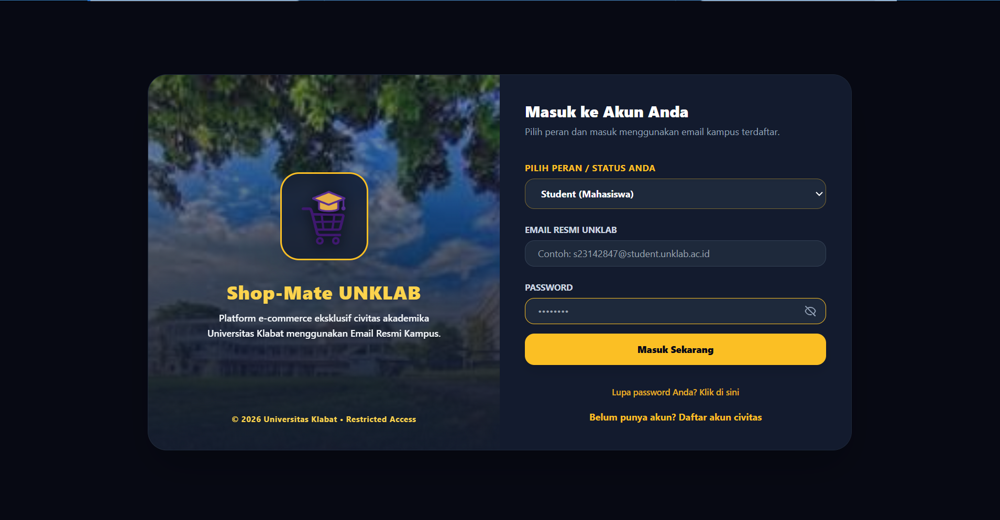
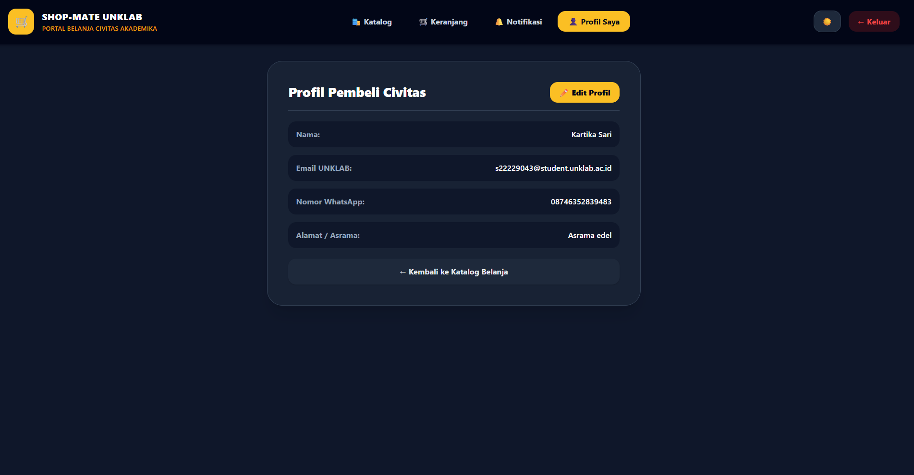
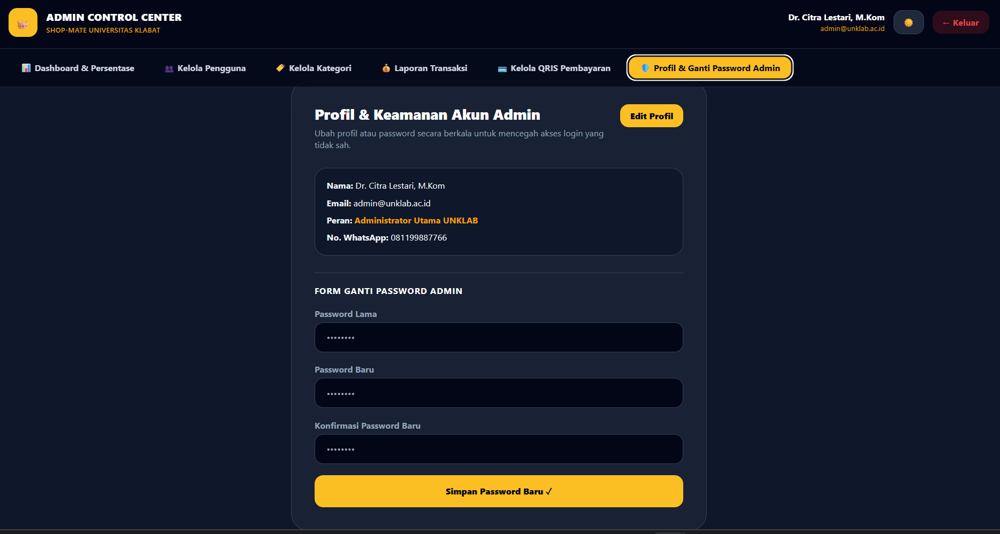
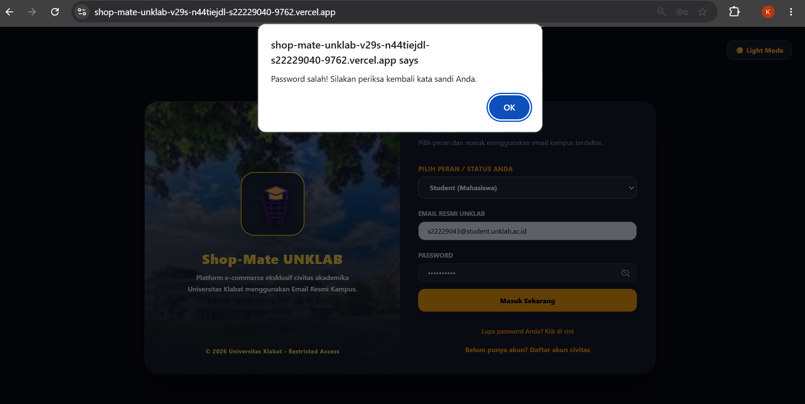
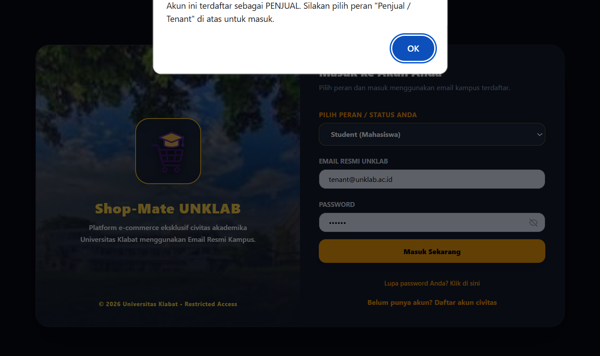
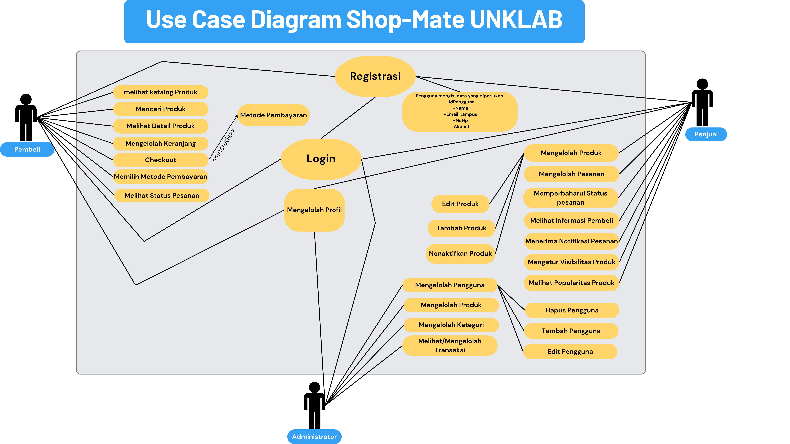

# Shop-Mate UNKLAB

Sistem informasi berbasis web berupa marketplace untuk lingkungan Universitas Klabat yang membantu Pembeli, Penjual, dan Administrator melakukan jual beli, mengelola produk dan pesanan, serta memantau transaksi agar proses jual beli di kampus lebih terstruktur dan tidak lagi tercecer di chat.



| | |
|---|---|
| **Mata kuliah** | System Analysis and Design — Fakultas Ilmu Komputer, Universitas Klabat |
| **Kelompok** | Well |
| **Objek / studi kasus** | Kegiatan jual beli mahasiswa, dosen, dan staf di Universitas Klabat |
| **Model SDLC** | Agile |
| **Dokumen SRS** | [docs/SAD_FP_Kelompok_Well_SRS.pdf](docs/SAD_FP_Kelompok_Well_SRS.pdf) |
| **Aplikasi (deploy)** | [https://shop-mate-unklab-v29s.vercel.app](https://shop-mate-unklab-v29s.vercel.app) |

## Anggota Kelompok

| No | Nama | NIM | Peran | Kontribusi utama |
|----|------|-----|-------|------------------|
| 1 | Pattilamonia, Christina J. | 105022410098 | Project Manager / Koordinator | Perencanaan jadwal, pengawasan task, koordinasi tim, repository |
| 2 | Palari, Sisiani | 105012410097 | System Analyst | Elisitasi kebutuhan, use case, dan activity diagram |
| 3 | Kartika Sari | 105012410022 | System Designer / Analis UML | Arsitektur basis data, ERD, dan class diagram |
| 4 | Ayu Ningsi | 105022410100 | UI/UX Designer | Wireframe dan rancangan antarmuka (L-01 s.d. L-24) |

## Latar Belakang

- **Masalah:** Penjual dan pembeli di kampus kesulitan melacak stok barang dan merekap pesanan karena semua dilakukan lewat chat; sering terjadi miskomunikasi stok.
- **Kondisi saat ini:** Penjual mengunggah foto barang di grup WhatsApp kampus, pembeli menghubungi lewat chat pribadi, harga dan tempat transaksi disepakati sendiri, dan pencatatan dilakukan manual di buku tulis atau Microsoft Excel.
- **Tujuan sistem:** Menyediakan satu tempat bagi warga kampus untuk menawarkan, mencari, dan memesan produk dengan alur yang jelas (keranjang, checkout, pemilihan metode pembayaran, dan pemantauan status pesanan), serta membantu Administrator mengelola pengguna, produk, kategori, dan transaksi.
- **Pengguna (aktor):**
  - **Pembeli**: mahasiswa, dosen, atau staf yang membeli produk.
  - **Penjual**: pengguna yang menjual produk dan memproses pesanan.
  - **Administrator**: pengelola sistem.

## Fitur Utama

Setiap fitur dipetakan ke use case dan kebutuhan di SRS (Bagian 5.2 dan 6.3).

| No | Fitur | Aktor | Use case | Kebutuhan |
|----|-------|-------|----------|-----------|
| 1 | Registrasi dan login | Semua aktor | UC-01, UC-02 | FR-01, FR-02 |
| 2 | Katalog, pencarian, dan detail produk | Pembeli | UC-03, UC-04, UC-05 | FR-03, FR-04, FR-05 |
| 3 | Keranjang, checkout, dan metode pembayaran | Pembeli | UC-06, UC-07, UC-08 | FR-06, FR-07, FR-08 |
| 4 | Status pesanan | Pembeli | UC-09 | FR-09 |
| 5 | Kelola profil | Semua aktor | UC-10 | FR-10 |
| 6 | Kelola produk dan stok (tambah, edit, nonaktifkan, visibilitas) | Penjual | UC-11, UC-12, UC-13, UC-14, UC-19 | FR-11, FR-12, FR-13, FR-14, FR-19 |
| 7 | Kelola pesanan, status, informasi pembeli, dan notifikasi | Penjual | UC-15, UC-16, UC-17, UC-18 | FR-15, FR-16, FR-17, FR-18 |
| 8 | Popularitas produk | Penjual | UC-20 | FR-20 |
| 9 | Kelola pengguna | Administrator | UC-21, UC-22, UC-23, UC-24 | FR-21, FR-22, FR-23, FR-24 |
| 10 | Kelola produk dan kategori | Administrator | UC-25, UC-26 | FR-25, FR-26 |
| 11 | Laporan transaksi | Administrator | UC-27 | FR-27 |
| 12 | Tambahan di antarmuka: laporan saldo dan keuangan (Penjual), kelola QRIS pembayaran (Administrator), mode terang/gelap | Penjual, Administrator, semua aktor | — | — |

## Screenshot

**Halaman pertama: login dan registrasi (UC-01, UC-02)**


**Dashboard Pembeli: katalog, keranjang, checkout, status pesanan (UC-03 s.d. UC-09)**


**Dashboard Penjual: kelola produk dan stok, pesanan masuk, laporan saldo (UC-11 s.d. UC-20)**


**Dashboard Administrator: pengguna, kategori, laporan transaksi, QRIS (UC-21 s.d. UC-27)**


**Profil Pembeli (UC-10)**



**Profil Penjual (UC-10)**


**Profil dan ganti password Administrator (UC-10)**



**Validasi input: pesan error saat password salah**



**Validasi peran: pesan error saat peran yang dipilih tidak sesuai dengan akun**



## Teknologi

| Lapisan | Teknologi | Versi |
|---------|-----------|-------|
| Front-end | React, Vite, Tailwind CSS | lihat `frontend/package.json` |
| Back-end | Node.js (Express) | lihat `backend/package.json` |
| Database | MySQL / MariaDB | - |
| Hosting | Vercel (publikasi otomatis dari GitHub) | — |
| Tools pemodelan | draw.io | — |

## Kebutuhan Sistem

- Untuk membuka aplikasi: browser modern (Chrome, Edge, Firefox) dan koneksi internet.
- Untuk menjalankan secara lokal (opsional): Node.js 20 atau lebih baru, MySQL 8 atau XAMPP, dan Git.

## Menjalankan Aplikasi

### Lewat tautan Vercel

Aplikasi sudah dipublikasikan dan dapat dibuka langsung di browser:
[https://shop-mate-unklab-v29s.vercel.app](https://shop-mate-unklab-v29s.vercel.app).
Pengguna baru dapat mendaftar lewat halaman registrasi, lalu masuk sesuai perannya.

Setiap perubahan kode dipublikasikan ke Vercel dengan mengirimkannya ke GitHub:

```bash
git add .
git commit -m "pesan perubahan"
git push origin main
```

### Menjalankan secara lokal (opsional)

1. Clone repository:

   ```bash
   git clone https://github.com/s22229040-dotcom/shop-mate-unklab.git
   cd shop-mate-unklab
   ```

2. Siapkan database. Buat database baru, lalu impor skema dan data awal dari `database/schema.sql`:

   ```bash
   mysql -u root -p [nama_database] < database/schema.sql
   ```

3. Siapkan dan jalankan back-end. Buat file `.env` di folder `backend/` berisi konfigurasi koneksi database (host, user, password, dan nama database) sesuai yang dibaca `config/db.js`, lalu:

   ```bash
   cd backend
   npm install
   node server.js
   ```

4. Jalankan front-end di terminal lain:

   ```bash
   cd frontend
   npm install
   npm run dev
   ```

5. Buka [http://localhost:5173](http://localhost:5173) di browser.

## Struktur Folder

Struktur kode mengikuti rancangan di SRS Bagian 10.2. Halaman pada `frontend/src/pages/` mengacu pada rancangan antarmuka (SRS Bagian 9) dan dibagi berdasarkan peran aktor.

```text
shop-mate-unklab/
├── .vscode/
├── backend/                       # logika server dan API
│   ├── config/
│   │   └── db.js                  # koneksi ke database MySQL
│   ├── node_modules/              # dependensi (otomatis)
│   ├── .env                       # konfigurasi lokal (koneksi database), tidak dibagikan
│   ├── package-lock.json
│   ├── package.json
│   └── server.js                  # titik masuk server dan rute API
├── database/
│   └── schema.sql                 # skema tabel dan data awal (SRS Bagian 8)
├── docs/
│   ├── diagrams/                  # use case diagram, class diagram, ERD
│   │   ├── class_diagram.png
│   │   ├── erd.png
│   │   └── use_case_diagram.png
│   └── SAD_FP_Kelompok_Well_SRS.pdf
├── frontend/
│   ├── dist/                      # hasil build (otomatis)
│   ├── docs/screenshots/          # screenshot untuk README
│   ├── node_modules/              # dependensi (otomatis)
│   ├── public/                    # aset statis (logo.png, download.jpg)
│   ├── src/
│   │   ├── pages/                 # halaman sesuai peran aktor
│   │   │   ├── login.jsx                 # registrasi dan login (UC-01, UC-02)
│   │   │   ├── Dashboard.jsx             # dashboard Pembeli (UC-03 s.d. UC-09)
│   │   │   ├── SellerDashboard.jsx       # dashboard Penjual (UC-11 s.d. UC-20)
│   │   │   ├── AdminDashboard.jsx        # dashboard Administrator (UC-21 s.d. UC-27)
│   │   │   ├── FacultyDashboard.jsx      # dashboard dosen/staf
│   │   │   └── Profile.jsx               # kelola profil (UC-10)
│   │   ├── App.jsx                # routing dan kontrol akses berdasarkan peran
│   │   ├── index.css              # gaya global (Tailwind)
│   │   └── main.jsx               # titik masuk aplikasi
│   ├── .gitignore
│   ├── index.html
│   ├── package-lock.json
│   ├── package.json
│   ├── postcss.config.js
│   ├── tailwind.config.js
│   └── vite.config.js
├── .gitignore
├── README.md
└── vercel.json                    # konfigurasi deploy Vercel
```

## Rancangan Sistem

Ringkasan rancangan; detail lengkap ada di dokumen SRS.

| Artefak | Lokasi |
|---------|--------|
| Kebutuhan fungsional dan non-fungsional | SRS Bagian 5 |
| Use case diagram dan description (UC-01 s.d. UC-27) | SRS Bagian 6.2 dan 6.3 · `docs/diagrams/use_case_diagram.png` |
| Activity diagram (AD-01 s.d. AD-27) | SRS Bagian 6.4 |
| Sequence diagram (SD-01 s.d. SD-27) | SRS Bagian 7.1 |
| Class diagram | SRS Bagian 7.2 · `docs/diagrams/class_diagram.png` |
| Model data (ERD) | SRS Bagian 8 · `docs/diagrams/erd.png` · `database/schema.sql` |
| Rancangan antarmuka (24 halaman, L-01 s.d. L-24) | SRS Bagian 9 |
| Matriks keterlacakan | SRS Bagian 10.3 |

**Use case diagram**



**Class diagram**


**ERD**


## Pengujian

Ringkasan: **3 kasus uji, 2 lulus, 1 belum dijalankan**. Daftar lengkap ada di SRS Bagian 10.4 (metode Black-Box Testing).

| ID | Use case | Skenario | Hasil diharapkan | Status |
|----|----------|----------|------------------|--------|
| TC-01 | UC-02 | Login dengan email dan password benar | Masuk ke dasbor | Lulus |
| TC-02 | UC-02 | Login dengan password salah | Pesan error tampil | Lulus |
| TC-03 | UC-07 | Checkout saat keranjang kosong | Tombol checkout nonaktif | Pending |

## Keterbatasan dan Pengembangan Berikutnya

- Pembayaran hanya disimulasikan (pemilihan metode pembayaran), belum terhubung ke payment gateway.
- Integrasi API kurir pihak ketiga (mis. JNE/J&T) tidak termasuk ruang lingkup.
- Fitur wishlist, ulasan produk, dan media sosial tidak termasuk ruang lingkup.
- Antarmuka dirancang untuk tampilan desktop dan berbahasa Indonesia.
- [Bug yang diketahui dan belum diperbaiki]
- [Rencana pengembangan]

## Penggunaan AI dan Referensi

| Alat AI | Dipakai untuk | Yang diperiksa atau diubah dari hasilnya |
|---------|---------------|------------------------------------------|
| LLM | Penyusunan teks laporan (SRS Bagian 1–12) | [isi :Pengecekan tata bahasa dan kesesuaian format tabel] |
| Claude | Membantu melihat error pada kode dan menyusun README | [isi: Pengecekan error dan melihat belum sesuai diREADME] |
| Gemini | Membantu rencana pembuatan web | [isi: perencanaann web dan penyusunan ]

Referensi:

1. React — https://react.dev
2. Vite — https://vite.dev
3. Tailwind CSS — https://tailwindcss.com
4. Node.js — https://nodejs.org
5. Express — https://expressjs.com
6. MySQL — https://dev.mysql.com/doc
7. Dokumentasi Vercel — https://vercel.com/docs